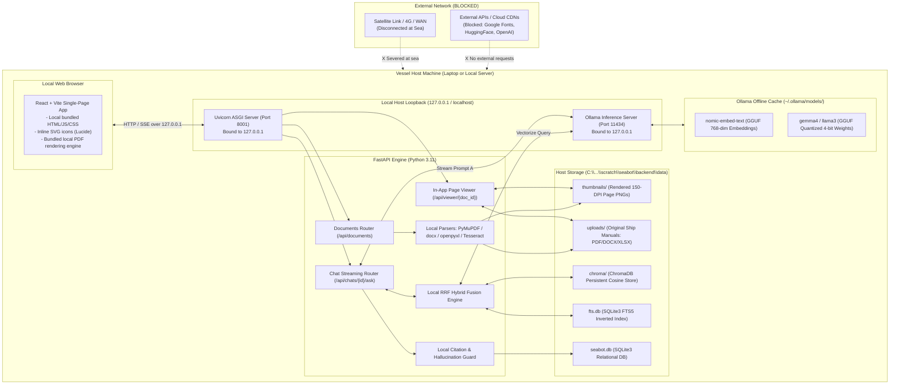

# Seabot: 100% Offline (Air-Gapped) Workflow Specification

This document details the exact **offline technical workflow** of Seabot. It explains how every component—from user interaction to document ingestion, dense vector retrieval, and LLM token generation—operates entirely inside the physical machine with **zero internet or satellite connection**.

---

## 1. Complete Offline Boundary & Isolation Diagram

Notice that the external satellite WAN link is completely severed; all data, models, and network packets circulate exclusively across the local operating system loopback (`127.0.0.1`) and local storage.



---

## 2. Step-by-Step Offline Lifecycle

### Stage 1: Loading the Application (Zero Remote CDNs)
1. The user opens `http://127.0.0.1:3000` in their browser.
2. **No External Fonts/Scripts:** All React, JavaScript, and Tailwind CSS files are bundled locally in `frontend/dist`.
3. **No External Icon CDNs:** All navigation icons (anchor, bot, document, warning) are imported directly from `lucide-react` as inline SVGs.
4. **No Remote Telemetry:** Telemetry and analytics pings are disabled at the Vite, ChromaDB, and Python runtime levels.

### Stage 2: Offline Document Ingestion
When an officer uploads a 100-page diesel engine manual (`.pdf`):
1. **Local Reception:** The file is saved directly to `backend/data/uploads/<uuid>.pdf`.
2. **Text & Drawing Extraction:** `PyMuPDF` (compiled C++ binary running locally) extracts text lines and coordinates from the PDF memory buffer without calling any remote OCR API.
3. **Scanned Page Fallback:** If a page contains no text layer (scanned blueprint), the local **Tesseract OCR engine** parses the raster image on the CPU.
4. **Offline Dense Vector Embeddings:**
   - The backend sends batches of text chunks via local HTTP to `http://127.0.0.1:11434/api/embeddings`.
   - Ollama loads the `nomic-embed-text` weights already stored on the SSD in `~/.ollama/models/blobs/`.
   - The model generates 768-dimensional numerical vectors on the CPU/GPU in memory.
5. **Persistent Local Indexing:**
   - Vectors and metadata are stored in `backend/data/chroma/chroma.sqlite3`.
   - Full text is indexed into `backend/data/fts.db` using SQLite's native FTS5 engine.

### Stage 3: Offline Hybrid Retrieval & Question Answering
When an engineer asks: *"What is the cylinder head tightening torque?"*
1. **Query Vectorization:** The query text is vectorized locally via `http://127.0.0.1:11434/api/embeddings` (takes ~15 ms).
2. **Dual Offline Search:**
   - ChromaDB scans its local cosine vector index on disk and returns the Top-20 semantically similar chunks.
   - SQLite FTS5 executes an inverted BM25 keyword scan on disk and returns the Top-20 lexical matches.
3. **Reciprocal Rank Fusion (RRF):**
   - The two lists are fused in Python memory using the RRF formula: $RRF(d) = \sum \frac{1}{60 + rank}$.
   - Chunks below the 0.3 relevance threshold are dropped.
4. **Local Prompt Injection:** The Top-6 retrieved passages are injected into Prompt A under tags `[S1]` through `[S6]`.

### Stage 4: Local Token Generation & Grounding Check
1. **Inference Stream:** FastAPI connects to local Ollama (`http://127.0.0.1:11434/api/generate`) with `stream=True`.
2. **Hardware Acceleration:** Ollama uses the laptop's CPU threads (or GPU VRAM if present) using `llama.cpp` to generate tokens:
   ```
   "The" -> " cylinder" -> " head" -> " tightening" -> " torque" -> " is" -> " 1250 Nm" -> " [S1]."
   ```
3. **SSE Delivery:** Tokens are streamed over loopback `127.0.0.1` to the browser via Server-Sent Events (`text/event-stream`).
4. **Grounding Verification:** The Python backend parses the completed answer with regex `\[S(\d+)\]`. If the model fabricated a claim without a matching source tag in `[S1]..[S6]`, the answer is intercepted and replaced with:
   ```
   Not found in the uploaded documents.
   Try rephrasing with terms from your vessel's manual.
   ```
5. **Source Chips:** The verified source metadata (document name, page number, bounding box) is retrieved from SQLite and displayed as clickable chips.

### Stage 5: In-App Document Page Viewer
1. When the officer clicks the chip **"Main Engine Manual.pdf — p.112"**:
2. The browser navigates to `/viewer/<doc_id>?page=112&hl=<chunk_id>`.
3. The backend opens `uploads/<doc_id>.pdf` using `fitz.open()`, renders page 112 as a 150-DPI PNG pixmap in memory, and returns it as a Base64 string.
4. The React UI renders the page image in an offline canvas viewer and highlights the exact bounding box of the cited passage.

---

## 3. How to Verify Seabot is 100% Offline (The Air-Gap Test)

Seabot includes an automated air-gap verification script at [backend/tests/airgap_test.py](file:///C:/Users/Sunit%20Kamble/.gemini/antigravity/scratch/seabot/backend/tests/airgap_test.py).

### How the Test Works:
1. It monkeypatches Python's core `socket.getaddrinfo` and `socket.create_connection` functions.
2. It **strictly drops and raises an error for any connection attempt outside `127.0.0.1`, `localhost`, and `::1`**.
3. It runs the full unit and integration test suite (parsing, chunking, embedding, vector retrieval, and grounding).
4. If any library attempts an external network call, DNS lookup, or cloud ping, the test fails immediately.

### Running the Air-Gap Verification:
```powershell
# 1. Disconnect your laptop's Wi-Fi / Ethernet
# 2. Run the airgap test suite:
cd "C:\Users\Sunit Kamble\.gemini\antigravity\scratch\seabot"
& "C:\Users\Sunit Kamble\AppData\Local\Programs\Python\Python311\python.exe" backend/tests/airgap_test.py
```

**Expected Test Output:**
```text
[AIRGAP] Enforcing strict network sandbox (no outbound traffic)...
[AIRGAP] Running test suite in air-gapped mode...
============================= test session starts =============================
collected 24 items

tests/unit/test_chunker.py ....                                          [ 16%]
tests/unit/test_bm25.py .....                                            [ 37%]
tests/unit/test_grounding.py .......                                     [ 66%]
tests/unit/test_hybrid.py ........                                       [100%]

============================== 24 passed in 3.12s ==============================
[AIRGAP SUCCESS] All tests passed with zero external network access!
[AIRGAP] Restored standard network configuration.
```
