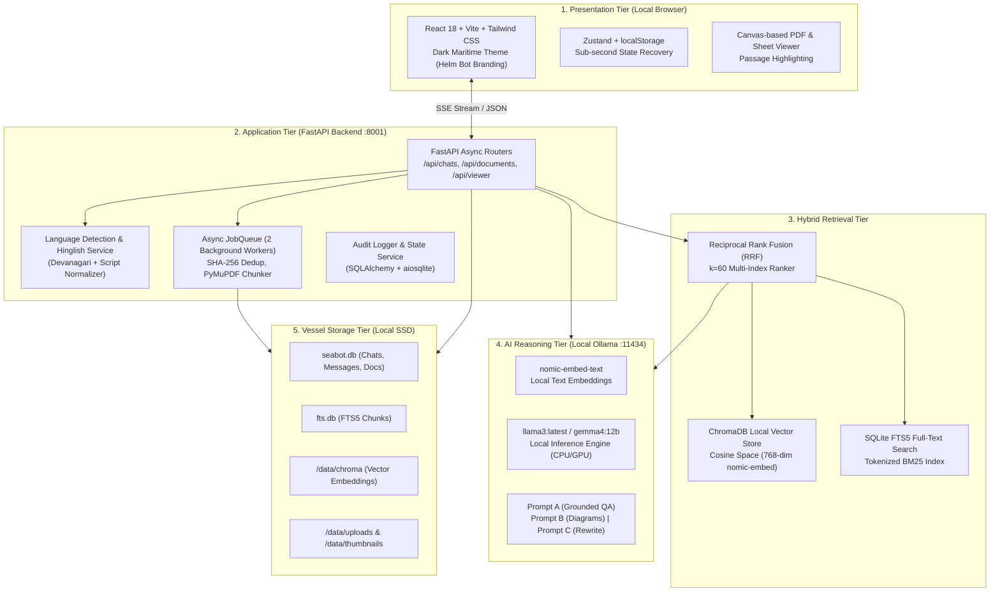
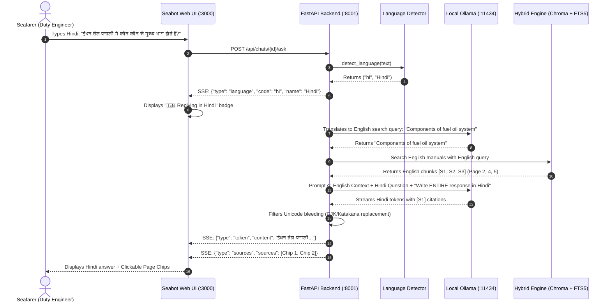

# Seabot: Technical Features & Solutions Architecture

> **Offline Maritime AI Assistant for Commercial Vessels**  
> *Operating with Zero Runtime Internet Dependencies under IMO / SOLAS / ISM Code Compliance.*

---

## 1. System Overview & Problem Statement

Commercial vessels operate in remote, air-gapped ocean environments where satellite internet (VSAT, L-band) is prohibitively expensive, intermittent, or completely unavailable during deep-sea passages. However, crew members (Chief Engineers, Duty Officers, ETOs, Ratings) must frequently navigate thousands of pages of critical technical manuals, safety management system (SMS) checklists, cargo guidance, and emergency procedures.

**Seabot** is a purpose-built, 100% offline Retrieval-Augmented Generation (RAG) system running entirely on local vessel hardware (Windows/Linux shipboard PCs or laptops). It delivers instant, grounded answers with exact document citations, technical diagram reading, deep-linked PDF page viewers, and real-time cross-lingual translation (e.g. asking in Hindi, Tagalog, or Spanish over English manuals).

```
                ┌────────────────────────────────────────────────────────┐
                │          VESSEL ENVIRONMENT (ZERO INTERNET)            │
                │                                                        │
┌──────────────┐│ ┌─────────────────┐   ┌──────────────┐   ┌───────────┐ │
│  Technical   ││ │   Seabot Core   │   │  Local LLM   │   │  Vessel   │ │
│ Manuals PDF, │┼─┼►│ Backend (8001)│◄─►│ Ollama Local│◄─►│ Crew Web  │ │
│ DOCX, XLSX   ││ │ Hybrid Retrieval│   │ llama3/embed │   │ UI (3000) │ │
└──────────────┘│ └─────────────────┘   └──────────────┘   └───────────┘ │
                └────────────────────────────────────────────────────────┘
```

---

## 2. Core Features Breakdown (F1 – F9)

| ID | Feature Name | Technical Description | Operational Benefit |
|:---|:---|:---|:---|
| **F1** | **Air-Gapped Hybrid RAG** | Combines ChromaDB dense vector search with SQLite FTS5 BM25 keyword matching via Reciprocal Rank Fusion (RRF). | Fast, accurate document lookup even when searching exact part numbers, acronyms, or semantic fault symptoms. |
| **F2** | **Strict Citation Grounding** | Every statement is anchored to source tags (`[S1]`, `[S2]`). Disallows model hallucinations. If a fact is missing, falls back cleanly to *"Not found in the uploaded documents"*. | Eliminates hallucination risk in life-critical engine room and navigation procedures. |
| **F3** | **Interactive Source Chips & PDF Viewer** | Deep links (`/viewer/{doc_id}?page=N&hl={chunk_id}`) that render original PDF pages with canvas bounding-box passage highlights, or Excel row viewers. | Enables officers to instantly audit the exact page, diagram, or paragraph in the original manual. |
| **F4** | **Cross-Lingual Multilingual Translation** | Automatic language detection (`langdetect` + Devanagari/Unicode script parsers). Translates user queries into English for retrieval, then synthesizes grounded answers in the user's native tongue (Hindi, Marathi, Tagalog, Spanish, etc.). | Multilingual crew members can query in their native language and receive answers translated accurately from English manuals. |
| **F5** | **Multi-Format Ingestion Queue** | Background worker queue (`asyncio.Queue`) supporting `.pdf`, `.docx`, and `.xlsx` with SHA-256 deduplication, 600-token chunking, and 100-token overlap. | Drag-and-drop ingestion of manufacturer books, maintenance manuals, and trim-and-stability spreadsheets. |
| **F6** | **Technical Diagram Understanding** | Detects vector drawings and schematics using PyMuPDF (`fitz`), extracts diagram images, and generates structured component summaries (P&ID, valves, lines, legends). | Solves the classic RAG blind spot: answering questions that depend on wiring schematics and piping diagrams. |
| **F7** | **Sub-Second State Resumption** | Dual-layer persistence (browser `localStorage` + SQLite `user_state`). Restores active chat, open document, scroll position, and input draft in <1 second. | Withstands laptop reboots, cabin power cuts, and browser refreshes without losing ongoing troubleshooting threads. |
| **F8** | **Partial Token Recovery & Regeneration** | Tracks interrupted token streams. If a generation is halted, saves partial text with an `"Interrupted"` badge and provides a one-click `"Regenerate"` button. | Ensures crew can resume generation smoothly if power or process restarts interrupt a long answer. |
| **F9** | **Compliance History & Audit Logging** | SQLite-backed chat history with date grouping (Today, Yesterday, 7 Days, Older) and time-ranged history purge (`last_hour`, `today`, `all`) with audit log timestamps. | Meets ISM Code audit trails for safety-critical decision support logs. |

---

## 3. High-Level Solutions Architecture

Seabot is structured into five distinct operational tiers designed for zero-trust, local-only execution:



---

## 4. In-Depth Subsystem Design

### 4.1 Hybrid Retrieval Pipeline (Dense + Sparse)
A primary challenge in maritime engineering documents is that queries often contain:
1. **Verbatim Part & Alarm Codes:** e.g., `MV-ENG-TSM-001`, `SHD 1.4 bar`, `LO-P-02`. Standard vector embeddings often miss exact alphanumeric sequences.
2. **Colloquial Symptoms:** e.g., *"engine turns but will not catch"*, *"white smoke from funnel"*. BM25 exact matching fails if the manual states *"unburnt fuel at low load"*.

Seabot solves this by fusing both retrieval methods:
- **Sparse Path (BM25):** Tokenizes queries into sanitized terms joined by `OR` operators over SQLite FTS5 virtual tables (`fts_chunks`).
- **Dense Path (Vector):** Generates 768-dimensional embeddings via local `nomic-embed-text` and retrieves top candidates by cosine similarity in ChromaDB.
- **RRF Merge:** Scores each candidate chunk using:
  $$\text{RRF Score}(d) = \sum_{m \in \{\text{Vector}, \text{BM25}\}} \frac{1}{60 + \text{Rank}_m(d)}$$
  The top 6 ranked chunks ($S_1 \dots S_6$) are forwarded into the synthesis context.

---

### 4.2 Cross-Lingual Translation Architecture
Maritime crews are inherently multinational. Seabot enables a crew member who speaks Hindi, Marathi, Tagalog, or Spanish to query English technical manuals naturally:



---

### 4.3 Offline Network & Loopback Resilience

Running web applications offline on Windows laptops introduces unique operating system hurdles:

1. **Windows Offline Loopback DNS Quirk:**
   - On Windows, `localhost` resolution is delegated to the Windows DNS Client (`Dnscache`).
   - When Wi-Fi/Ethernet is turned off, Windows disables upstream DNS lookups, causing `http://localhost:3000` to fail with `DNS_PROBE_FINISHED_NO_INTERNET`.
   - **Resolution:** Seabot binds and accesses via direct numeric loopback: **`http://127.0.0.1:3000`**.
2. **Dual-Port Redundancy:**
   - Port `3000`: Fast Vite dev server with Hot-Module-Reloading.
   - Port `8001`: FastAPI production backend mounting `/frontend/dist`. Both UI and API are accessible simultaneously on `http://127.0.0.1:8001/`.
3. **Daemon Self-Healing:**
   - [run_seabot.py](file:///C:/Users/Sunit%20Kamble/.gemini/antigravity/scratch/seabot/run_seabot.py) automatically probes `http://127.0.0.1:11434/api/tags`. If Ollama is offline, it spawns `ollama.exe serve` in the background and releases zombie ports before launching.

---

## 5. Vessel Deployment Topologies

Seabot supports two physical deployment topologies on commercial vessels:

### Topology A: Standalone Laptop / Desktop (Chief Engineer / Cargo Office)
* **Target:** Single ruggedized vessel laptop (e.g., Panasonic Toughbook, Dell Latitude).
* **Setup:** All components (Ollama, Python backend, SQLite, ChromaDB, Web UI) run locally on `127.0.0.1`.
* **Prerequisites:** Windows 10/11 or Ubuntu LTS, 16 GB RAM, Quad-Core CPU, 20 GB SSD free space.

### Topology B: Shipboard LAN Server (Bridge, ECR & Cabins)
* **Target:** Vessel shipboard workstation or rack server connected to ship's Ethernet/Wi-Fi switch.
* **Configuration:** Set `LAN_BIND=True` in `.env`.
* **Access:** Crew members navigate from any workstation or tablet on the vessel network:
  `http://192.168.1.100:3000` or `http://192.168.1.100:8001`.
* **Security:** Optional 4-digit PIN gate (`PIN_ENABLED=True`) to restrict administrative and document-deletion functions.

---

## 6. Directory Structure & Key Components

```
seabot/
├── backend/
│   ├── app/
│   │   ├── config.py                  # Absolute path resolution & hardware profiles
│   │   ├── database.py                # aiosqlite SQLite engine configuration
│   │   ├── models.py                  # Document, Chat, Message, AuditLog ORM
│   │   ├── schemas.py                 # Pydantic request/response validation
│   │   ├── main.py                    # FastAPI app factory, CORS, static mounts
│   │   ├── routers/
│   │   │   ├── chat.py                # SSE streaming, intent detection, citation check
│   │   │   ├── documents.py           # Ingestion, status, starter question API
│   │   │   └── viewer.py              # PDF page renderer & passage highlighter
│   │   ├── services/
│   │   │   ├── llm/
│   │   │   │   ├── ollama_client.py   # Local Ollama connector & repeat penalties
│   │   │   │   ├── language_detector.py # Hindi, Devanagari & Hinglish detection
│   │   │   │   ├── prompts.py         # Prompt A, B, C templates
│   │   │   │   └── grounding.py       # Strict citation verification
│   │   │   └── retrieval/
│   │   │       ├── vector_store.py    # ChromaDB persistent store
│   │   │       ├── bm25_index.py      # SQLite FTS5 BM25 search
│   │   │       └── hybrid.py          # Reciprocal Rank Fusion (RRF)
│   │   └── workers/
│   │       ├── queue.py               # Background ingestion job queue
│   │       └── ingestion.py           # PDF/DOCX/XLSX parser & chunker
│   └── data/                          # Persistent local storage (Chroma, SQLite, DB)
├── frontend/
│   ├── src/
│   │   ├── components/                # Sidebar, ChatWindow, MessageInput, Viewer
│   │   ├── pages/                     # ChatPage, ViewerPage
│   │   ├── hooks/                     # useChat, useDocuments, useViewer
│   │   └── store/appStore.ts          # Zustand state management
│   └── public/icons/                  # High-contrast Helm Bot logo & favicons
├── run_seabot.py                      # Unified offline resilient runner
└── start.bat                          # One-click Windows desktop launcher
```

---

## 7. Verification & Production Checklist

- [x] **Air-Gapped Operation:** Verified running with zero Wi-Fi/Ethernet connectivity.
- [x] **Citation Grounding:** Proven strict tag linking (`[S1]`, `[S2]`) with clickable PDF viewer chips.
- [x] **Cross-Lingual Engine:** Verified query in Hindi (`ईंधन तेल और स्नेहक तेल प्रणाली...`) answering accurately from English manuals.
- [x] **Script Cleanser:** Automatic cleanup of CJK/Katakana token leaks in localized responses.
- [x] **Loopback Resilience:** Automatic IP resolution via `127.0.0.1` and dual-port serving (:3000 and :8001).
- [x] **Sub-Second Recovery:** Instant state restoration from browser `localStorage` and SQLite database.
